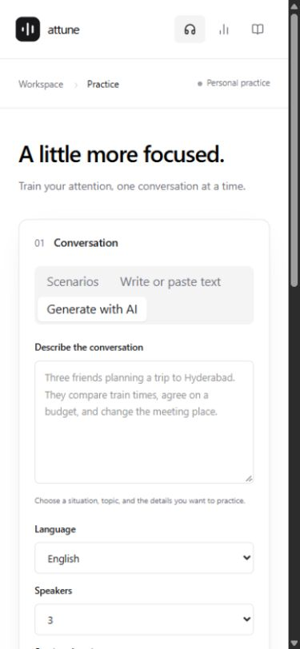
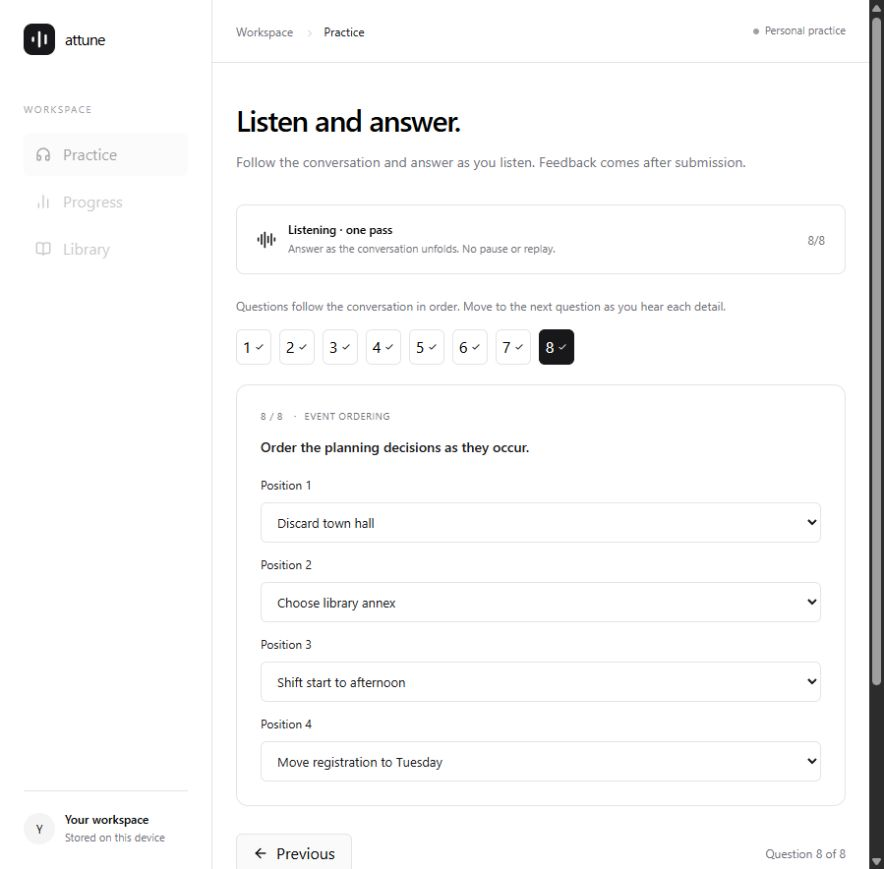
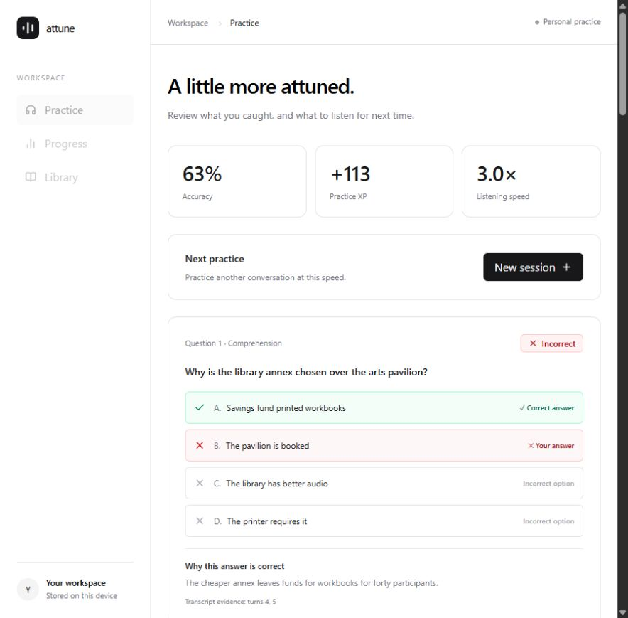
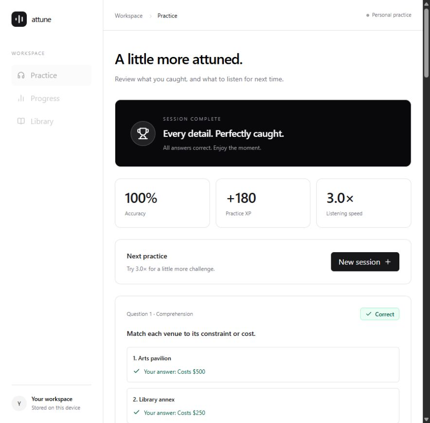

# Attune Listening Trainer [Gen AI]

**Generate a conversation. Listen once. Answer as you listen.**

Attune is a multilingual listening-practice app for auditory attention, speaker recognition, working memory, and precise recall. Describe a scenario, write your own dialogue, or choose a curated conversation. OpenRouter generates dialogue; ElevenLabs converts it into multi-speaker speech. An IELTS-style answer sheet stays usable while the recording plays, and feedback unlocks after the complete question set is submitted.



## Project classification

**Generative AI application — LLM + neural text-to-speech.** Attune integrates pretrained language and speech models through OpenRouter and ElevenLabs. These providers use deep-learning models. This repository does **not** train or fine-tune a new ML/DL model; it contains no model weights or training dataset. Question construction uses the LLM with transcript evidence and structural validation. Answer grading is deterministic application code with accepted answer variants.

## Features

- **Generate with AI:** describe a real-life situation; choose English, Telugu, or Hindi, 2–6 speakers, and **2, 5, 10, or 15 minute targets**. Each session includes 8, 12, 18, or 24 questions respectively, spanning all six formats.
- **Write or paste text:** enter a title and `Speaker: dialogue` turns or import a `.txt` file.
- **Automatic Library:** generated conversations save immediately; valid written/imported edits save after a short debounce. Prepared curated conversations are saved too. Saved conversations stay on this device.
- **One setup panel:** conversation, session summary, and start action share one surface. Optional Settings reveal practice mode, language, speed, speech provider, voices, sounds, and visual effects.
- **Multilingual speech:** assign distinct ElevenLabs voices. `eleven_v3` supports English, Hindi, and Telugu without installed operating-system voices. Device speech is an optional English-only alternative.
- **Prepare, then listen:** render MP3 audio before starting. Scored playback has no in-app pause, stop, scrub, or replay controls.
- **Listen and answer:** IELTS-style mode shows one focused question at a time with Previous/Next and an answered-question navigator. Questions follow the latest transcript turn needed to answer them, so the test follows the recording rather than grouping questions randomly by format. Submission stays locked until the recording ends and all questions are complete.
- **Memory practice:** an alternate mode hides questions until the audio finishes.
- **Delayed feedback:** score, XP, explanations, correct answers, full transcript, and suggested next speed appear after submission. Perfect scores trigger ribbons, soft flares, and a win chime; other scores receive encouraging or neutral tones. Sounds and effects can be disabled in Settings. Reduced-motion preferences suppress animations.
- **Progress:** completed sessions, average accuracy, XP, and day streaks stay in browser-local storage.
- **Adjustable speed:** 0.5×–3.0× playback, with 1.0× as the default.

### Question formats

| Format | Interaction |
| --- | --- |
| Multiple choice | Select a detail, reason, intent, or inference |
| Fill in the blank | Type a missing spoken word |
| True / false | Judge a claim against the conversation |
| Matching | Match plans, constraints, reasons, or outcomes |
| Short answer | Type a concise recall answer |
| Event ordering | Sequence events or decisions |

Question generation tests content and reasoning rather than identifying a voice by gender. Speakers introduce their names, and a scenario/cast brief appears before listening. Each question includes an explanation and transcript turn references. Result review labels every choice with a check or cross, identifies your answer and the correct answer, and corrects matching/ordering rows individually. Grading accepts harmless case, punctuation, and whitespace differences. Partial matching and ordering answers are blocked; ordering must use every turn once.







## Product flow

1. In **Practice**, select **Scenarios**, **Write or paste text**, or **Generate with AI**.
2. Describe a scene and choose the language, speakers, and length.
3. Review the generated dialogue. It saves automatically to Library; choose **Use for listening** to continue.
4. Use the defaults or open **Settings** to change the practice mode, provider, voices, or speed.
5. Assign different voices, set playback speed, and click **Prepare session**.
6. Click **Start listening**. In live mode, answer in chronological order and use **Next question** as the conversation unfolds.
7. Finish every answer and submit after playback. Review feedback and the transcript.
8. Open **Progress** for history or **Library** for saved dialogue.

This independent practice tool is inspired by listening-exam interaction. It is not an official IELTS product, complete IELTS exam simulator, or IELTS band-score predictor.

## Stack and architecture

| Layer | Technology |
| --- | --- |
| Interface | React 19, TypeScript, Tailwind CSS 4, local shadcn/ui components, Radix, Lucide |
| Framework | Next.js App Router conventions through Vinext, Vite 8 |
| Runtime | Cloudflare Workers through Sites |
| Dialogue generation | Server-side OpenRouter Chat Completions with JSON Schema output |
| Default LLM | `google/gemini-3.8-flash`; configurable with `OPENROUTER_MODEL` |
| Speech | ElevenLabs Text to Dialogue, `eleven_v3` |
| Playback | Browser audio object with selected playback rate and no exposed controls |
| Persistence | Browser localStorage for saved dialogue and history |
| Tests | Node test runner for grading, completeness, and Unicode handling |

```text
Prompt + duration → /api/generate → OpenRouter → validated dialogue + assessment → editable preview
Dialogue + voices → ordered chunks → /api/speech → ElevenLabs → MP3 playlist → one-pass playback
Edited/manual dialogue → /api/questions → content-based assessment → live answer sheet → grading
Completed sessions / saved dialogue → browser localStorage
```

Provider requests run on authenticated server routes. Keys never belong in the browser bundle. The server validates origin and input bounds, applies timeouts, and rejects overlapping generation requests per user within a Worker instance. Provider-side key limits cap account usage. Existing owner-private hosted access is preserved; publishing this repository does not make the hosted app public.

## Local setup

Use **Node.js 22.13+** and npm. Provider accounts need valid API access and available credits.

```sh
npm install
cp .env.example .env.local
npm run dev
```

On PowerShell, use `Copy-Item .env.example .env.local`. Put credentials only in the ignored environment file. The development server prints its local URL, normally port 5173. The supplied Sites plugin provides mock local sign-in; production uses Sites authentication.

| Variable | Purpose |
| --- | --- |
| `OPENROUTER_API_KEY` | Conversation generation |
| `ELEVENLABS_API_KEY` | Multi-speaker speech |
| `OPENROUTER_MODEL` | Optional model override |

ElevenLabs permissions: Text to Speech, Voices Read, and Models. Configure provider/key usage limits for your budget. Do not commit `.env.local`, `.dev.vars`, or keys. In production, configure hosted secrets and deploy again to apply changes.

```sh
npx tsc --noEmit
npm test
npm run build
```

The build emits Worker and client assets under `dist/`. Preserve the supplied Sites Vite integration. The public repository includes a neutral hosting manifest without the original private Site identity; configure your own Site before publishing another instance.

## Source map

```text
app/api/generate/          OpenRouter dialogue generation
app/api/questions/         Content-based assessment generation
app/api/voices/            ElevenLabs voice discovery
app/api/speech/            MP3 generation
app/api/status/            Non-secret provider readiness
app/chatgpt-auth.ts        Hosted/local identity helpers
src/App.tsx                Practice, playback, review, library, progress
src/components/            Conversation studio and live answer sheet
src/components/ui/         Owned UI primitives
src/lib/questions.ts       Completeness, normalization, and grading
src/lib/session-content.ts Duration, introductions, and chunking
src/lib/audio.ts           Measured audio playlist playback
lib/assessment.ts          Structured LLM assessment requests
lib/training-api.ts        Authorization, validation, provider errors
worker/                    Cloudflare runtime entry
scripts/                   Framework and Sites build tooling
tests/                     Focused grading and Unicode tests
docs/images/               Real product screenshots
```

## Verification

- Real OpenRouter generation was exercised through the UI and saved for later listening.
- Real ElevenLabs audio was prepared and played in a scored session.
- All six question formats were answered while the recording played. Submission remained locked until audio completion, then correctly graded 100% and 90 XP.
- Hindi and Telugu speech routes returned actual MP3 audio successfully without system voice installation.
- A two-part ElevenLabs recording was measured (2:02 at normal speed), played through at 3.0×, and submitted with deliberate wrong answers to verify option labels and matching/ordering corrections.
- The sequential six-format answer flow was exercised with a browser-local QA fixture and real two-part ElevenLabs audio. The perfect-score flow reached 100%, played its synthesized chime without console errors, and displayed the celebration. Sound/effect preferences persisted across reloads.
- Narrow-screen setup layout was checked at 390px with no horizontal overflow. Device speech did not reliably finish in the test browser; the optional fallback now has a timeout and recommends ElevenLabs.
- Automated tests cover partial/duplicate ordering, matching, normalized answers, Telugu combining marks, long-script chunking, introductions, duration targets, and chronological assessment order.
- Real two-minute conversation/assessment generation passed. A live fifteen-minute generation check was not completed: initial output failed length validation and OpenRouter account credits then became unavailable. Longer conversations now use connected generation sections, but that provider path still needs a funded live check.

## Limits and privacy

- Duration is a target at 1.0×, not an exact recording length. The app measures and displays actual prepared audio duration. Faster/slower playback changes session time.
- Dialogue supports 4–240 turns and up to 60,000 characters. Longer speech is prepared in ordered parts below the provider character limit; all parts must finish before a scored listen begins. Successful parts are reused when retrying preparation. Long sessions need sufficient provider credits. Parts can have short transitions.
- Pronunciation and voice quality come from the speech provider. Automated checks verify output and playback lifecycle, not human-perceived accent or intelligibility.
- Prompts go to OpenRouter and the selected model provider. Dialogue goes to ElevenLabs. Saved dialogue and progress remain local; cross-device sync is not implemented.
- In-app controls enforce one-pass practice. Browser developer tools, operating-system controls, and device failures remain outside that boundary. Interrupted attempts are discarded.
- Generated assessments are structurally validated, but LLM answers/explanations can still be wrong. Evidence references support review; they are not independent factual verification. Editing dialogue invalidates the old question bank. Open-ended semantic answers are not graded by an LLM. Instructions and feedback are in English.
- Offline AI generation is not implemented. Audio is temporary for the current session, not permanently archived.
- XP and streaks support consistency. The app makes no clinical or validated cognitive-improvement claim.

## Documentation

- [OpenRouter Chat Completions](https://openrouter.ai/docs/api/api-reference/chat/create-a-chat-completion)
- [ElevenLabs Text to Dialogue](https://elevenlabs.io/docs/api-reference/text-to-dialogue/convert)
- [ElevenLabs voice discovery](https://elevenlabs.io/docs/api-reference/voices/search)

Third-party starter/vendor licenses are retained alongside their files.
